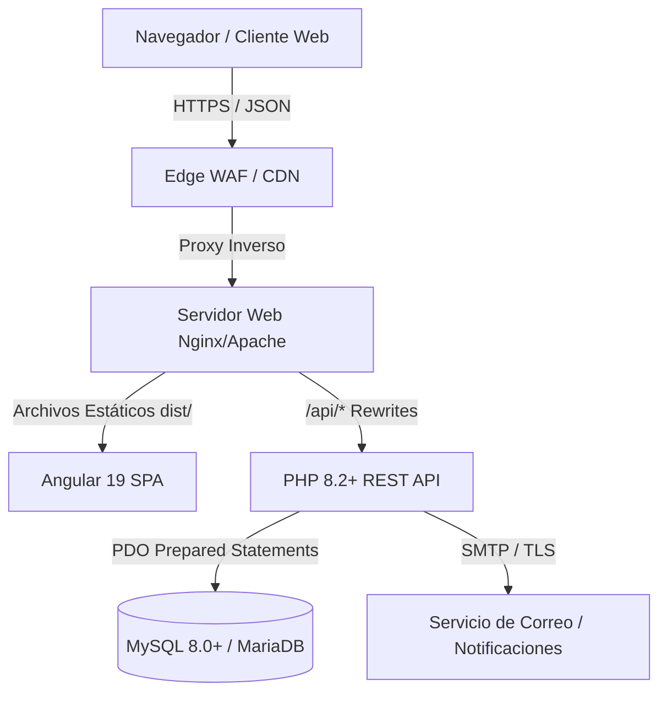

# Arquitectura del Sistema — Ocean Drive Car Rental

## 1. Visión General del Sistema

Ocean Drive Car Rental es una plataforma desacoplada compuesta por:
1. **Frontend SPA**: Construido con **Angular 19+** (Zoneless-ready, Standalone Components, Reactive Signals, Tailwind CSS).
2. **Backend API**: API REST modular en **PHP 8.2+** orientada a objetos (PDO con MySQL/MariaDB, Rate Limiter integrado, JWT/Session Auth, CORS configurable).
3. **Persistencia**: Base de datos relacional MySQL optimizada con índices para consultas de disponibilidad temporal y reservas concurrentes.



---

## 2. Frontend (Angular 19)

### Estructura de Directorios

```
src/
├── app/
│   ├── guards/               # Route guards (AuthGuard, AdminGuard, BookingStepGuard)
│   ├── interceptors/         # HttpInterceptors (AuthInterceptor inyectando Bearer tokens)
│   └── pages/                # Páginas lazy-loaded principales
│       ├── admin/            # Dashboard administrativo empresarial (Inventory, Bookings, Users, Availability)
│       ├── booking/          # Vistas de confirmación y resumen de reservas
│       ├── home/             # Landing comercial
│       ├── login/ & register/# Módulos de autenticación
│       ├── paso-1 a paso-5/  # Flujo transaccional guiado de reserva de vehículos
│       └── profile/          # Perfil de usuario y consultas de reservas históricas
├── components/               # Componentes Standalone reutilizables (Calendario, Flota, Modales, Tarjetas)
├── data/                     # Mock data estructurada y constantes estáticas
├── services/                 # Servicios globales (ApiService, BookingService, LanguageService, CurrencyService)
├── styles.css                # Sistema de tokens CSS, animaciones y directivas de Tailwind
└── main.ts                   # Bootstrap de la aplicación con ZoneCoalescing, Router y Http
```

### Patrones de Diseño Frontend
- **Signals & OnPush**: Todo componente implementa `ChangeDetectionStrategy.OnPush` para minimizar repintados en el DOM.
- **Micro-interacciones y Animaciones**: Sincronizadas mediante View Transitions API y Tailwind CSS.
- **Rutas y Lazy Loading**: Módulos administrativos y pasos de reserva cargados bajo demanda como Lazy Chunks para reducir el bundle inicial.

---

## 3. Backend (PHP REST API)

### Estructura de Capas

```
server/
├── public/
│   ├── index.php             # Front controller, router central y dispatching de endpoints
│   └── .htaccess             # Reglas mod_rewrite, headers de seguridad y enrutamiento a index.php
└── src/
    ├── Auth.php              # Lógica de autenticación, hash de contraseñas y validación de sesiones
    ├── Booking.php           # Máquina de estados de reservas, cálculo de tarifas y validación de disponibilidad
    ├── Category.php          # Gestión de categorías de vehículos
    ├── config.php            # Carga segura de variables de entorno (.env)
    ├── ContactRequest.php    # Formularios de contacto y leads comerciales
    ├── Cors.php              # Control de orígenes cruzados (CORS) y preflight OPTIONS
    ├── Database.php          # Singleton de conexión PDO con modo de error PDO::ERRMODE_EXCEPTION
    ├── Mailer.php            # Generador y despachador de emails HTML transaccionales
    ├── Marketing.php         # Gestión de campañas y suscriptores
    ├── RateLimiter.php       # Limitador de tasa (Token Bucket) contra scraping y fuerza bruta
    ├── User.php              # Gestión de usuarios, roles (Admin/Customer) y perfiles
    └── Vehicle.php           # CRUD de inventario, atributos y estado del vehículo
```

### Seguridad y Blindaje
- **Prevención de Inyección SQL**: Todas las consultas a MySQL utilizan `prepare()` y parámetros vinculados vía PDO.
- **Rate Limiting**: `RateLimiter.php` restringe solicitudes por IP en endpoints sensibles (`/login`, `/register`, `/bookings/create`).
- **Control de Acceso Basado en Roles (RBAC)**: Protección a nivel de endpoint validando rol `admin` antes de despachar rutas `/api/admin/*`.
