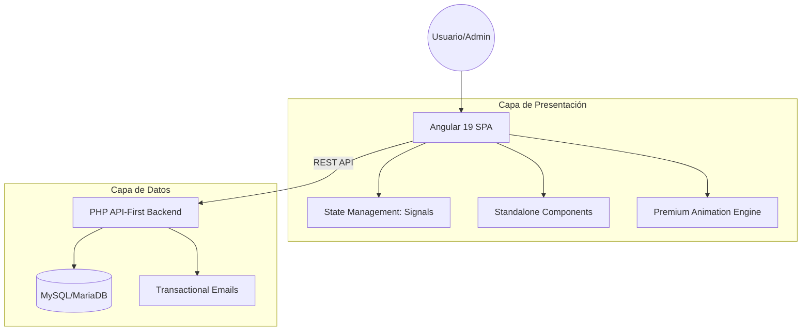

# 005-publicacion-profesional-github-FINAL.md

## Descripción del Objetivo
Este plan proporciona el contenido **final y optimizado** para los archivos de documentación y configuración necesarios para publicar el proyecto en GitHub con estándares de **Senior Web Engineer**. Se incluyen bloques de código listos para copiar y pegar.

---

## 🛠️ Archivos para Copiar y Pegar

### 1. `LICENSE` (Raíz del proyecto)
> [!IMPORTANT]
> Copia este contenido en un nuevo archivo llamado `LICENSE` en la raíz.

```text
MIT License

Copyright (c) 2026 Ocean Drive Car Rental

Permission is hereby granted, free of charge, to any person obtaining a copy
of this software and associated documentation files (the "Software"), to deal
in the Software without restriction, including without limitation the rights
to use, copy, modify, merge, publish, distribute, sublicense, and/or sell
copies of the Software, and to permit persons to whom the Software is
furnished to do so, subject to the following conditions:

The above copyright notice and this permission notice shall be included in all
copies or substantial portions of the Software.

THE SOFTWARE IS PROVIDED "AS IS", WITHOUT WARRANTY OF ANY KIND, EXPRESS OR
IMPLIED, INCLUDING BUT NOT LIMITED TO THE WARRANTIES OF MERCHANTABILITY,
FITNESS FOR A PARTICULAR PURPOSE AND NONINFRINGEMENT. IN NO EVENT SHALL THE
AUTHORS OR COPYRIGHT HOLDERS BE LIABLE FOR ANY CLAIM, DAMAGES OR OTHER
LIABILITY, WHETHER IN AN ACTION OF CONTRACT, TORT OR OTHERWISE, ARISING FROM,
OUT OF OR IN CONNECTION WITH THE SOFTWARE OR THE USE OR OTHER DEALINGS IN THE
SOFTWARE.
```

---

### 2. `README.md` (Optimizado)
> [!TIP]
> Este README incluye un diagrama de arquitectura Mermaid y secciones detalladas de tecnología.

```markdown
# Ocean Drive Car Rental 🚗✨

<div align="center">
  
  
  
  
  
</div>

<div align="center">
  <strong>Plataforma empresarial de próxima generación para el alquiler de vehículos premium en el Caribe Colombiano.</strong>
</div>

---

## 🌊 Visión General
**Ocean Drive** no es solo un sitio web de reservas; es un sistema de gestión de flota integral (EMS) construido con los estándares más altos de la ingeniería web moderna. Enfocado en la **experiencia de usuario fluida** y el **rendimiento extremo**, utiliza Angular 19 en modo Zoneless para garantizar una respuesta instantánea.

## 🏗️ Arquitectura del Sistema



## 🚀 Capacidades Técnicas

### Core de Ingeniería
- **⚡ Zoneless Change Detection**: Optimización proactiva eliminando la sobrecarga de `zone.js`.
- **🔄 Signals Architecture**: Flujo de datos reactivo y predecible en todo el árbol de componentes.
- **🎨 Tailwind CSS + Custom Motion**: Combinación de diseño utilitario con un sistema de curvas de animación personalizadas (`ease-apple`).
- **🌐 i18n Engine**: Soporte nativo para multi-idioma con persistencia de preferencias.

### Panel Administrativo (Admin Console)
- **Calendario Inteligente**: Visualización de disponibilidad en tiempo real con estados complejos (Pickup/Dropoff/Split).
- **Tarifas Dinámicas**: Motor de reglas para temporadas especiales y precios base.
- **Gestión de Flota**: Control total sobre placas, estados de mantenimiento y categorías.

## 🛠️ Instalación y Desarrollo

```bash
# Instalación de dependencias
npm install

# Servidor de desarrollo
npm start

# Verificación de tipos (Strict Mode)
npx tsc --noEmit

# Build de producción
npm run build
```

## 📂 Estructura del Proyecto
- `src/app/pages`: Vistas principales con Lazy Loading.
- `src/app/services`: Lógica de negocio e integración con API.
- `src/components`: UI Atoms & Molecules standalone.
- `server/src`: Lógica de backend orientada a objetos (PHP).

## 📄 Licencia
Este proyecto está bajo la licencia **MIT**. Consulta el archivo `LICENSE` para más detalles.

---
<div align="center">
  <sub>Desarrollado con arquitectura Senior para el Caribe Colombiano 🇨🇴</sub>
</div>
```

---

### 3. `.gitignore` (Premium)
> [!NOTE]
> Esta versión asegura que ningún artefacto de sistema, IDE o dependencias se filtre al repositorio.

```text
# Dependency directories
node_modules/
vendor/

# Build outputs
dist/
dist-ssr/
.angular/
.cache/

# Local configuration & Secrets
.env
.env.*
! .env.example
secrets/
*.key
*.pem
config.local.php

# IDEs and Editors
.vscode/
!.vscode/extensions.json
.idea/
*.iml
*.iws

# System files
.DS_Store
Thumbs.db

# Logs
*.log
logs/
npm-debug.log*

# Testing
coverage/
.nyc_output/
```

---

## Plan de Verificación

1. **Localmente:**
   - [ ] Crear los archivos con el contenido proporcionado.
   - [ ] Ejecutar `git status` para confirmar que `.gitignore` está funcionando (ej: `node_modules` no debe aparecer).
   - [ ] Ejecutar `npm run build` para asegurar que el README no afecta el proceso de construcción.

2. **En GitHub:**
   - [ ] Verificar que el diagrama Mermaid se visualiza correctamente en la interfaz de GitHub.
   - [ ] Confirmar que los Badges redirigen o muestran el estado correcto.
